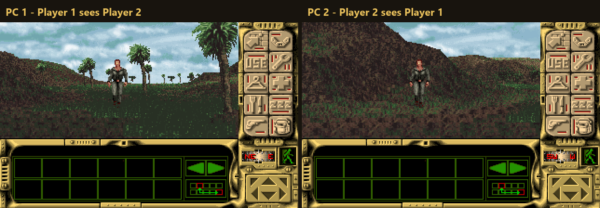
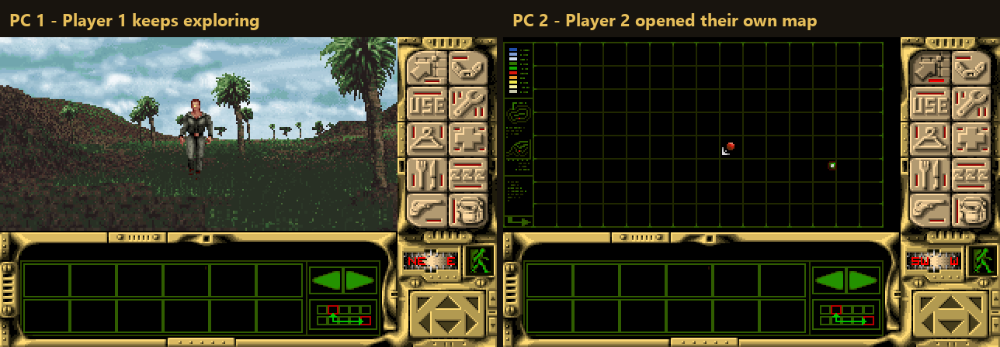

<p align="center"></p>

# Robinson's Requiem: Win Native &amp; Online Co-op

*Robinson's Requiem* (Silmarils, 1994) running **natively on Windows**: no DOSBox, no emulator.
Play it **alone**, or **online co-op** with a friend on another PC. In co-op, each player has their **own character**:
their own body, wounds, illnesses, hunger and thirst, their own inventory and equipment, and their own map and computer screens.





## Features
- **Native Windows program**: the game's own scripts run on a native ALIS engine (no DOSBox, no emulation).
  Single player plays like the original, plus WASD controls and a fullscreen option.
- **Online co-op on 2 PCs**: one player hosts, the other joins with the host's IP address.
  Join at any time: the second player gets the host's game state and appears next to player 1.
- **Separate characters**: health, body temperature, wounds, illnesses, food and water, inventory, equipment.
- **Each PC shows its own player's view**: own camera, own HUD and compass, own map (F1) and computer (F2).
  Players see each other in the world.
- **Co-op saves**: a save also stores player 2 (`<name>.SAV.p2`); loading it brings player 2 back.
  Only the host can load a save or start a new game.
- **WASD controls** on top of the original mouse/numpad: W/S forward/back, A/D turn, Q/E sidestep.
- **Installer** that uses *your* copy of the game (GOG or any other PC version): nothing from the game is in this repository
  or in the download. Even the program icon is made on your PC from your game's art.

## Install
1. Own the PC version of Robinson's Requiem (e.g. from GOG).
2. Run `RRQ-Native-Setup-<version>.exe` from [Releases](../../releases). It finds your game, copies the game files into
   its own folder (your original install is not changed) and creates Start menu shortcuts: **Play**, **Host Co-op**, **Join Co-op**.
3. Online co-op: the host forwards TCP port **27531** (or both use a LAN/VPN tool such as ZeroTier, Tailscale or Radmin VPN).

## How it works (short)
The game logic lives in 124 scripts run by the ALIS virtual machine (Silmarils' own game system). This project runs them on
a native engine (based on [maestun/alis](https://github.com/maestun/alis), in `engine/`) and adds co-op at the engine level:
- the player's state (about 2.8 KB of the game's variables) is kept per player and swapped in for each player's entities;
- player 2 gets their own instances of the player scripts (hero, controller, mouse/UI, body simulation, compass);
- world entities (animals, NPCs, objects) act for the nearest player, or for the player who interacted with them;
- panels a player opens (map, computer) belong to that player, with their own palette and 3D-view state;
- online play is deterministic lockstep over TCP with a full state transfer on join and automatic resync on desync.

Analysis tools (Ghidra scripts, a disassembler for the ALIS scripts, variable tracing) are in `tools/`, notes in `PLAN.md`.

## Build
MSYS2 MinGW64 with CMake, Ninja and SDL2:
```sh
cmake -S engine -B build/engine-gui -G Ninja -DCMAKE_BUILD_TYPE=Release -DRRQ_GUI=ON
cmake --build build/engine-gui
sh installer/build.sh 0.1.0      # installer (needs NSIS: pacman -S mingw-w64-x86_64-nsis)
```

## Status
Test build. Known limits: player 2 is drawn with the game's own human figure; cutscenes are shared.

## Credits and legal
- Engine: based on [ALIS](https://github.com/maestun/alis) by Olivier Huguenot, Vadim Kindl and contributors (MIT).
- SDL2 (zlib license).
- *Robinson's Requiem* is (c) Silmarils. This is an unofficial fan project; it contains none of the game's files.
  You need your own copy of the game.
